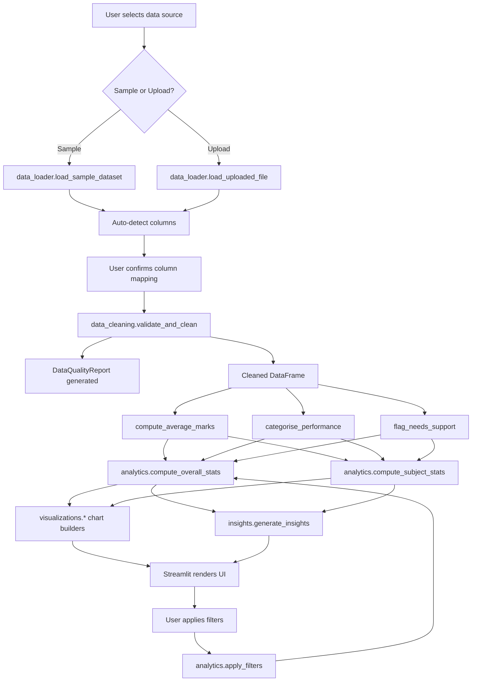

# Student Performance Analysis Dashboard
## Project Report — BTech Computer Science and Engineering

**Project Title:** Student Performance Analysis Dashboard Using Python  
**Technology:** Python, Streamlit, Pandas, Plotly  
**Data Type:** CSV / Excel (synthetic sample dataset included)  
**Student Name:** [Insert Student Name]  
**Roll Number:** [Insert Roll Number]  
**Department:** Computer Science and Engineering  
**Institution:** [Insert Institution Name]  
**Faculty Guide:** [Insert Guide Name]  
**Academic Session:** [Insert Year]  

---

## Chapter 1: Introduction

### 1.1 Background

Academic institutions collect large volumes of student performance data every semester. This data includes examination marks, attendance records, assignment scores, and other academic indicators. When this data is analysed systematically, it reveals patterns that help educators identify struggling students early, adjust teaching strategies, and allocate resources more effectively.

Despite the availability of this data, many institutions still rely on manual spreadsheet-based analysis. This approach is time-consuming, error-prone, and produces static outputs that cannot be interactively explored.

The Student Performance Analysis Dashboard addresses this gap by providing an automated, interactive, and visually rich analytical tool built entirely in Python.

### 1.2 Motivation

The motivation for this project stems from three observations made in educational contexts:

1. **Late identification of at-risk students.** Teachers often discover that a student is struggling only after mid-semester or end-semester examinations. Earlier identification allows timely intervention.
2. **Lack of accessible analytical tools.** Existing commercial systems are expensive, require technical expertise, and are difficult to customise for individual institutions.
3. **Untapped potential in existing data.** Student data already exists in spreadsheets and CSVs. Connecting a capable Python analytics layer to this data requires only a simple, accessible interface.

### 1.3 Problem Statement

Educational institutions generate student performance data regularly, but lack accessible tools to:
- Compute accurate subject-wise and overall statistics automatically.
- Visualise performance distributions and subject comparisons interactively.
- Flag students who require academic support based on configurable criteria.
- Export analysis results in structured formats for reporting.

This project proposes a locally-run Python dashboard that solves all four problems.

### 1.4 Project Objectives

The specific objectives of this project are:

1. Load student performance data from CSV or Excel files.
2. Validate and clean the data with transparent quality reporting.
3. Calculate subject-wise and overall performance statistics.
4. Categorise students by performance level.
5. Identify students who may need academic support.
6. Visualise performance data using interactive Plotly charts.
7. Analyse the relationship between attendance and academic performance.
8. Generate factual, automatically derived textual insights.
9. Apply interactive filters to explore subsets of the data.
10. Export cleaned data and analysis summaries.

### 1.5 Project Scope

**In scope:**
- CSV and Excel file loading with automatic column detection.
- Statistical analysis: averages, medians, standard deviations, pass/fail rates.
- Eight interactive Plotly chart types.
- Filtering by class, performance category, marks range, attendance, and search term.
- CSV downloads for cleaned data, performance report, and subject summary.
- Automated tests using pytest.

**Out of scope:**
- Online deployment or cloud hosting.
- User authentication or access control.
- Integration with existing school management systems.
- Historical trend analysis across multiple semesters.
- Advanced machine-learning prediction models.

### 1.6 Limitations

1. The application requires Python 3.11 or higher installed on the host machine.
2. Very large datasets (above 100,000 rows) may cause slower loading times in the browser.
3. The insight engine uses rule-based logic, not machine learning; insights are factual but not predictive.
4. The application does not persist data between sessions; data must be re-uploaded after restarting.

---

## Chapter 2: Existing and Proposed Systems

### 2.1 Problems with Manual Academic Analysis

In a typical manual workflow, a teacher or administrator:
1. Downloads mark sheets as spreadsheets.
2. Uses Excel formulas to calculate averages and totals.
3. Manually applies conditional formatting to highlight pass/fail.
4. Creates charts by hand.
5. Writes observations based on visual inspection.

This process has several practical problems:
- **Scalability:** Recalculating for 500 students across 10 subjects takes significant time.
- **Error rate:** Manual data entry and formula copy-paste errors are common.
- **Static output:** Once a chart is created, it cannot be interactively filtered.
- **No validation:** Excel does not flag impossible marks (e.g., 150/100) unless formulas are carefully constructed.
- **Repeatability:** Each analysis run must be repeated manually.

### 2.2 Limitations of Spreadsheet-Only Workflows

Spreadsheet tools like Microsoft Excel and Google Sheets are general-purpose tools not designed specifically for academic analytics. Their limitations in this context include:

- No built-in attendance correlation analysis.
- No configurable flagging of students who need support.
- No automatic insight generation from data.
- Sharing analysis requires exporting static files.
- Custom validations must be built from scratch for each dataset.

### 2.3 The Proposed System

The Student Performance Analysis Dashboard is a locally running Python web application that automates the entire analysis pipeline:

```
Upload CSV / Load Sample Data
        ↓
Validate and Clean Data
        ↓
Calculate Statistics
        ↓
Apply Filters
        ↓
Generate Charts and Insights
        ↓
Export Results
```

### 2.4 Advantages of the Proposed System

| Feature | Manual / Spreadsheet | Proposed Dashboard |
| --- | --- | --- |
| Data validation | Manual / formula-based | Automatic with detailed quality report |
| Chart creation | Manual | Automatic on data load |
| Filter updates | Must recreate charts | Instant — charts update with filters |
| Insight generation | Manual observation | Algorithmic from calculated statistics |
| Missing value handling | Ad hoc | Explicit configurable policy |
| Export | Static Excel file | Structured CSV + Markdown summary |
| Reproducibility | Low | High — deterministic calculations |
| Accessibility | Requires spreadsheet expertise | Browser-based, beginner-friendly |

---

## Chapter 3: Requirements Analysis

### 3.1 Functional Requirements

| ID | Requirement |
| --- | --- |
| FR-01 | Load CSV and Excel datasets |
| FR-02 | Provide an included synthetic sample dataset |
| FR-03 | Auto-detect standard column names |
| FR-04 | Allow manual column mapping |
| FR-05 | Validate marks in [0, 100] range |
| FR-06 | Validate attendance in [0, 100] range |
| FR-07 | Detect and report duplicate rows |
| FR-08 | Handle missing values with explicit policy |
| FR-09 | Compute per-student average marks |
| FR-10 | Compute per-subject statistics |
| FR-11 | Compute overall dataset statistics |
| FR-12 | Assign performance categories |
| FR-13 | Identify students below passing threshold |
| FR-14 | Identify students failing individual subjects |
| FR-15 | Identify students with low attendance |
| FR-16 | Compute attendance–marks correlation |
| FR-17 | Filter by class, category, marks, attendance, search |
| FR-18 | Display 8 interactive Plotly charts |
| FR-19 | Generate algorithmic textual insights |
| FR-20 | Export cleaned dataset as CSV |
| FR-21 | Export performance report as CSV |
| FR-22 | Export subject summary as CSV |
| FR-23 | Export analysis summary as Markdown |

### 3.2 Non-Functional Requirements

| Category | Requirement |
| --- | --- |
| Performance | Dashboard must load a 200-row dataset within 3 seconds on a standard laptop |
| Reliability | Application must not crash on missing or malformed data |
| Usability | All controls must be operable without technical training |
| Portability | Must run on Windows with Python 3.11+ installed |
| Maintainability | Code must be modular, documented, and testable |
| Privacy | No data is transmitted to external servers |
| Accuracy | All calculated statistics must match hand-verifiable results |

### 3.3 Software Requirements

| Software | Version | Purpose |
| --- | --- | --- |
| Python | 3.11 or later | Runtime |
| Streamlit | ≥ 1.32 | Web interface |
| Pandas | ≥ 2.2 | Data processing |
| NumPy | ≥ 1.26 | Numerical operations |
| Plotly | ≥ 5.20 | Interactive charts |
| openpyxl | ≥ 3.1 | Excel file support |
| pytest | ≥ 8.1 | Automated testing |
| Any modern web browser | — | UI display |

### 3.4 Hardware Requirements

| Component | Minimum |
| --- | --- |
| Processor | Dual-core 1.5 GHz |
| RAM | 4 GB |
| Storage | 500 MB free |
| Display | 1280 × 720 |

### 3.5 User Requirements

The primary users are:
- **Teachers:** Upload mark sheets and view subject performance.
- **Academic administrators:** Generate reports and identify at-risk students.
- **BTech students (demonstration):** Understand and explain every module during a viva.

---

## Chapter 4: System Design

### 4.1 System Architecture

The application uses a simple layered architecture:

```
┌─────────────────────────────────────────┐
│             Streamlit UI (app.py)        │
│  Sidebar │ KPI Cards │ Tabs │ Downloads  │
└──────────────────┬──────────────────────┘
                   │ calls
┌──────────────────▼──────────────────────┐
│              Source Modules (src/)       │
│  data_loader  │  data_cleaning           │
│  analytics    │  visualizations          │
│               │  insights                │
└──────────────────────────────────────────┘
                   │ reads
┌──────────────────▼──────────────────────┐
│              Data Layer                  │
│  data/sample_students.csv               │
│  Uploaded CSV / Excel file              │
└─────────────────────────────────────────┘
```

### 4.2 Data Flow



### 4.3 Module Descriptions

| Module | Responsibility |
| --- | --- |
| `app.py` | Streamlit UI, session state, orchestration |
| `src/data_loader.py` | File I/O, column auto-detection |
| `src/data_cleaning.py` | Validation, cleaning, missing-value policy, flagging |
| `src/analytics.py` | Statistical calculations, ranking, filtering |
| `src/visualizations.py` | Plotly figure factories (one function per chart) |
| `src/insights.py` | Algorithmic insight string generation |

### 4.4 Data Processing Workflow

1. **Load** raw data from CSV or Excel.
2. **Auto-detect** standard column names.
3. **Validate:** check types, ranges, duplicates, missing values.
4. **Clean:** coerce types, remove out-of-range values, optionally drop incomplete rows.
5. **Compute:** add `_avg_marks`, `_category`, and flag columns to the DataFrame.
6. **Filter:** apply sidebar filter selections.
7. **Analyse:** compute overall stats and subject stats on filtered data.
8. **Render:** pass statistics and the filtered DataFrame to chart/insight functions.

### 4.5 Data Validation Strategy

The validator in `data_cleaning.validate_and_clean` uses a fail-fast approach:
- If the dataset is empty → critical error, halt.
- If required subject columns are missing → critical error, halt.
- All other issues (out-of-range marks, duplicates, non-numeric cells) → warnings, continue with corrected data.

### 4.6 Missing Value Policy

Missing marks are **not** substituted with zero. Instead:
- Each calculation uses only the non-NaN values for that column/row.
- `pd.Series.mean(skipna=True)` ensures row-level averages use available data.
- A student with all subject marks missing receives NaN average and is excluded from pass/fail counts.
- A user-configurable option (`drop_incomplete`) lets users exclude rows with any missing marks.
- The Data Quality tab explicitly reports all missing values.

---

## Chapter 5: Methodology

### 5.1 Dataset Loading

`data_loader.py` uses `pandas.read_csv` for CSV files and `pandas.read_excel` (via openpyxl) for Excel files. The function returns a plain DataFrame plus an error string. The caller checks for errors before proceeding.

Auto-detection matches column names against curated sets of known variants (case-insensitive, normalised to lowercase with underscores).

### 5.2 Data Cleaning

The `validate_and_clean` function performs these steps sequentially:
1. Check for empty DataFrame.
2. Confirm subject columns exist.
3. Count missing values per column.
4. Coerce subject columns to numeric (non-numeric cells → NaN).
5. Set out-of-range marks (< 0 or > 100) to NaN.
6. Validate and clean attendance column.
7. Detect and optionally remove exact duplicate rows.
8. Detect duplicate student IDs.
9. Optionally drop rows with any missing marks.
10. Count valid student rows.

### 5.3 Statistical Calculations

All calculations are implemented in `analytics.py` using Pandas groupby, aggregation, and vectorised operations:

- **Overall average:** `df["_avg_marks"].mean()` (NaN-safe)
- **Pass count:** `(df["_avg_marks"] >= threshold).sum()`
- **Subject average:** `df[col].dropna().mean()`
- **Correlation:** `pd.Series.corr()` (Pearson)
- **Class comparison:** `df.groupby(class_col)["_avg_marks"].mean()`

### 5.4 Performance Categorisation

```python
if score >= 85:   "Excellent"
elif score >= 70: "Good"
elif score >= 50: "Average"
elif score >= 40: "Needs Improvement"
else:             "Below Threshold"
```

Category boundaries are fixed descriptive labels. The configurable passing threshold controls only the pass/fail split, not the category boundaries.

### 5.5 Visualisation

Each chart is a separate function in `visualizations.py` that accepts a DataFrame and returns a Plotly `Figure`. Charts include:
- Empty-data guards (`_safe_fig`) that return a blank figure with a message instead of crashing.
- Consistent colour palettes using `CATEGORY_COLORS` and `PASS_FAIL_COLORS`.
- Descriptive titles and axis labels.
- Interactive tooltips from Plotly's default hover behaviour.

### 5.6 Insight Generation

`insights.py` applies Python `if` conditions to the calculated statistics. For example:

```python
if valid_avgs.max() > valid_avgs.min():
    best_subj = valid_avgs.idxmax()
    insights.append(f"{best_subj} has the highest average...")
```

No external API is used. Every insight string references a concrete calculated value.

### 5.7 Filtering

Filters are applied in `analytics.apply_filters` using boolean masks:

```python
mask = pd.Series(True, index=df.index)
if selected_classes:
    mask &= df[class_col].isin(selected_classes)
if min_avg is not None:
    mask &= df["_avg_marks"] >= min_avg
# etc.
return df[mask].copy()
```

All charts, KPI cards, and insight text operate on the filtered DataFrame.

### 5.8 Export

Exports use `pandas.DataFrame.to_csv()` with `.encode("utf-8")` for Streamlit's `download_button`. The Markdown summary is built by string concatenation of calculated values, ensuring it always reflects the current analysis state.

---

## Chapter 6: Implementation

### 6.1 Module: data_loader.py

Loads CSV/Excel files and provides automatic column detection.

**Key function:**
```python
def load_uploaded_file(uploaded_file) -> tuple[pd.DataFrame, str]:
    filename = uploaded_file.name.lower()
    raw_bytes = uploaded_file.read()
    if filename.endswith(".csv"):
        df = pd.read_csv(io.BytesIO(raw_bytes))
    elif filename.endswith((".xlsx", ".xls")):
        df = pd.read_excel(io.BytesIO(raw_bytes), engine="openpyxl")
    else:
        return pd.DataFrame(), "Unsupported file type."
    return df, ""
```

### 6.2 Module: data_cleaning.py

Validates raw data and returns a `DataQualityReport` dataclass alongside the cleaned DataFrame.

**Key function:**
```python
def validate_and_clean(df, subject_cols, attendance_col=None, id_col=None,
                        drop_duplicates=True, drop_incomplete=False):
    # ... sequential validation steps ...
    return cleaned, report
```

### 6.3 Module: analytics.py

All statistical calculations. No Streamlit imports; this module is purely computational.

**Key function:**
```python
def compute_overall_stats(df, avg_col, passing_threshold=40.0, attendance_col=None):
    valid = df[avg_col].dropna()
    pass_count = int((valid >= passing_threshold).sum())
    return {
        "overall_average": round(float(valid.mean()), 2),
        "pass_count": pass_count,
        "pass_percentage": round(pass_count / len(valid) * 100, 2),
        ...
    }
```

### 6.4 Module: visualizations.py

Returns Plotly `Figure` objects for each chart type.

**Key function:**
```python
def subject_performance_bar(subject_stats: pd.DataFrame) -> go.Figure:
    data = subject_stats["Average"].dropna().reset_index()
    fig = px.bar(data, x="Average", y="Subject", orientation="h", ...)
    return fig
```

### 6.5 Module: insights.py

Generates insight strings from calculated statistics.

**Key function:**
```python
def generate_insights(overall_stats, subject_stats, passing_threshold, ...):
    insights = []
    if not subject_stats.empty:
        best_subj = valid_avgs.idxmax()
        insights.append(f"{best_subj} has the highest average...")
    return insights
```

### 6.6 Module: app.py

Orchestrates the application:
1. Configures the Streamlit page.
2. Injects minimal custom CSS.
3. Manages session state.
4. Renders the sidebar with data source selection, column mapping, thresholds, and filters.
5. Calls processing and analytics functions.
6. Renders eight tabs: Overview, Subjects, Students, Needs Support, Attendance, Insights, Data Quality, Export.

---

## Chapter 7: Testing and Results

### 7.1 Test Framework

Automated tests use **pytest**. All tests are located in the `tests/` directory.

Tests use small, hand-crafted DataFrames with deterministic expected values. No random data is used in tests.

### 7.2 Test Cases

#### test_data_cleaning.py (13 tests)

| Test | Description | Expected |
| --- | --- | --- |
| test_valid_dataset_cleans_without_errors | Valid 3-row DataFrame | No critical errors, 3 valid rows |
| test_empty_dataset_returns_critical_error | Empty DataFrame | Critical error with "no rows" message |
| test_missing_values_are_counted | 1 NaN in Math | missing_values ≥ 1 |
| test_duplicate_rows_detected_and_removed | Duplicated first row | duplicate_rows ≥ 1, len(cleaned) < original |
| test_marks_outside_range_set_to_nan | 150 and -5 in Math | invalid_mark_cells ≥ 2, NaN in cleaned |
| test_missing_subject_column_triggers_error | Non-existent column | Critical error |
| test_non_numeric_marks_coerced_to_nan | "AB" in Math | NaN present, warning added |
| test_drop_incomplete_removes_partial_rows | 1 NaN row, drop_incomplete=True | 2 rows remain |
| test_invalid_attendance_set_to_nan | 101 and -1 in Attendance | invalid_attendance_cells ≥ 2 |
| test_compute_average_marks_skips_nan | Mixed NaN across 2 subjects | Correct partial averages |
| test_categorise_performance_boundaries | Scores at category boundaries | Correct category strings |
| test_flag_needs_support_flags_low_averages | 3-row dataset, threshold 40 | Correct flag_any values |
| test_all_nan_row_gives_nan_average | All NaN row | NaN average |

#### test_analytics.py (16 tests)

| Test | Description | Expected |
| --- | --- | --- |
| test_overall_average_correct | 5-student dataset | 57.0 |
| test_pass_count_correct | threshold=40 | 4 pass, 1 fail |
| test_pass_percentage | 4/5 pass | 80.0% |
| test_subject_averages | Math and Science | Math=58.0, Science=56.0 |
| test_subject_pass_fail_counts | threshold=40 | Math: 4 pass 1 fail |
| test_subject_stats_handles_nan | 1 NaN in Math | Valid_Count=4, Average=50.0 |
| test_student_ranking_sorted_descending | 5 students | Descending order |
| test_tied_scores_same_rank | 2 students tied at 75 | Same rank |
| test_attendance_correlation_insufficient_data | 2-row dataset | None |
| test_attendance_correlation_valid | 5-row dataset | Value in [-1, 1] |
| test_overall_stats_no_attendance | No attendance col | avg_attendance=None |
| test_class_comparison | 2 classes | Correct per-class averages |
| test_apply_filters_class | Class="A" filter | 3 records |
| test_apply_filters_empty_result | min_avg=99 | Empty DataFrame |
| test_apply_filters_search_by_name | search="alice" | 1 record (Alice) |
| test_students_below_threshold | threshold=40 | 1 student (Dan, avg=22.5) |

#### test_insights.py (9 tests)

| Test | Description | Expected |
| --- | --- | --- |
| test_insights_non_empty_for_valid_data | 5-row dataset | Non-empty list |
| test_best_subject_in_insights | Math avg > Science avg | "Math" and "highest" in output |
| test_worst_subject_in_insights | Science avg < Math avg | "Science" and "lowest" in output |
| test_no_attendance_insight_when_no_col | attendance_col=None | "not supplied" in output |
| test_data_quality_warnings_appear | 2 warnings passed | "2" and "warning" in output |
| test_attention_insights_no_flagged | Empty flagged df | "no students" in output |
| test_attention_insights_with_flagged | 2 flagged students | "2" in output |
| test_insights_tied_subject_averages | Equal subject averages | No crash, list returned |
| test_insights_empty_dataframe | Empty df | No crash, list returned |

### 7.3 Test Results

> **Note:** Actual test results are generated by running `python -m pytest tests/ -v` after installation. See the actual output in the project's test logs.

### 7.4 Known Limitations

1. The application's Google Inter font requires an internet connection on first load. Analysis works fully offline.
2. Very large datasets (> 50,000 rows) may cause visible loading delays.
3. The insight engine does not perform predictive analysis — it reports on existing data only.
4. Attendance correlation is not computed when there are fewer than 3 valid paired observations.

---

## Chapter 8: Conclusion and Future Scope

### 8.1 Conclusion

The Student Performance Analysis Dashboard successfully achieves all stated objectives:

- It loads student data from CSV and Excel files with automatic column detection.
- It validates data comprehensively and reports quality issues transparently.
- It calculates overall and subject-wise statistics accurately using Pandas.
- It renders eight interactive Plotly charts that update with filter selections.
- It identifies and explains which students may need academic support.
- It generates factual, algorithmic insights without requiring an external AI service.
- It exports analysis results in structured formats suitable for reporting.

The system is modular, tested, beginner-friendly, and suitable for live academic demonstration.

### 8.2 Future Scope

The following enhancements would be appropriate for a more advanced version:

1. **Database Integration:** Store multi-semester data in SQLite or PostgreSQL for historical trend analysis.
2. **User Authentication:** Add role-based access so teachers can view only their classes.
3. **Historical Comparisons:** Compare current semester performance against previous semesters.
4. **Additional File Formats:** Support PDF mark sheets via OCR.
5. **Predictive Analytics:** Use scikit-learn to build early-warning models for at-risk students.
6. **Email Alerts:** Notify parents or advisors when a student is flagged.
7. **Multi-language Support:** Localise the interface for regional languages.
8. **Mobile-Responsive Layout:** Optimise the interface for tablet and mobile viewing.

---

## References

1. Streamlit — Open-source app framework for Python. https://docs.streamlit.io
2. Pandas — Python Data Analysis Library. https://pandas.pydata.org/docs
3. Plotly Python Graphing Library. https://plotly.com/python
4. NumPy — Scientific computing with Python. https://numpy.org/doc
5. pytest — Testing framework for Python. https://docs.pytest.org
6. openpyxl — A Python library to read/write Excel files. https://openpyxl.readthedocs.io

> **Dataset Note:** The sample dataset (`data/sample_students.csv`) is entirely synthetic. All student names, IDs, and marks are computer-generated. No real student data was used.

> **Institutional Note:** This project was completed as an independent academic exercise. It has not been supervised by any external organisation or commercial entity.
